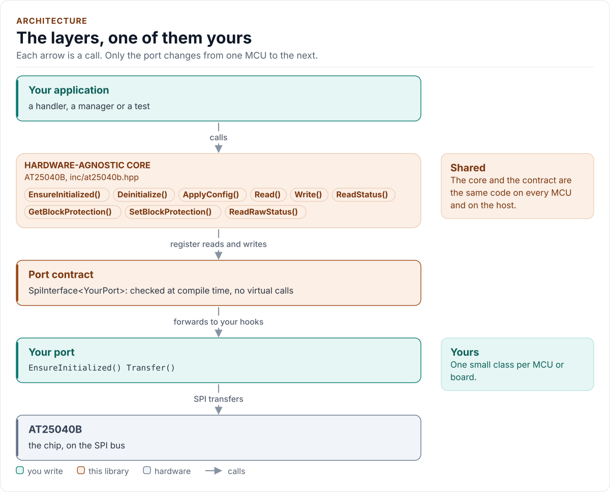

# AT25040B Driver

C++20 driver for the Microchip AT25010B, AT25020B and AT25040B SPI serial EEPROMs.

[](https://github.com/kokeb-labs-drivers/driver-at25040b/actions/workflows/ci.yml)
[](LICENSE)
[](docs/installation.md#requirements)

**Documentation: [`docs/`](docs/index.md)**, with the API reference built by Doxygen ([how](docs/api-reference.md)).
The site at <https://kokeb-labs-drivers.github.io/driver-at25040b/> opens when the repository is public.

The AT25010B, AT25020B and AT25040B keep 128, 256 or 512 bytes with no power: a board's identity, a calibration, a boot
counter. This driver checks that a chip really answers before it trusts the bus, reads any range, writes page by page
with the write enable latch and the write cycle checked (and, when a call asks for it, a read-back), drives the WP pin
only while it writes, and sets the block protection. It runs on any MCU: you give it a small class that moves bytes on
your SPI bus and waits, and it does the rest.

<!-- figure: driver-layers -->
<picture>
  <source media="(prefers-color-scheme: dark)" srcset="docs/diagrams/driver-layers.dark.svg">
  
</picture>
<!-- /figure -->

## At a glance

| | |
| --- | --- |
| **Chips** | Microchip (Atmel) AT25010B (128 B), AT25020B (256 B), AT25040B (512 B); SOIC, TSSOP, UDFN, XDFN, VFBGA; 1.8 V to 5.5 V |
| **Memory** | 8-byte pages, self-timed write cycle of 5 ms at most, 1,000,000 write cycles |
| **Bus** | SPI mode 0 or 3; 20 MHz from 4.5 V, 10 MHz from 2.5 V, 5 MHz from 1.8 V |
| **Protection** | WP pin (driven by the driver if your port has the hook), write enable latch, non-volatile block protection |
| **Driver** | Header-only C++20; no heap, exceptions, RTTI or virtual calls; every call returns `Result<T>` |
| **Runs on** | Any MCU with SPI and a C++20 compiler; examples for ESP32 (ESP-IDF) and the host |
| **Status** | 0.1.0, **not verified on hardware**: host-tested against a protocol model of the chip and fuzzed. See what is and is not verified ([limitations](docs/limitations.md)) |

## Datasheet

<!-- generated: datasheet-card -->
| Document | Revision | Get it |
| --- | --- | --- |
| Datasheet: AT25010B, AT25020B, AT25040B SPI Serial EEPROM (Microchip (Atmel) Atmel-8707) | F, 2015-01 | [PDF](https://ww1.microchip.com/downloads/en/DeviceDoc/Atmel-8707-SEEPROM-AT25010B-020B-040B-Datasheet.pdf) · [vendor page](https://www.microchip.com/en-us/product/AT25040B) |

Written against these revisions; the SHA-256 of each file is in [`docs/datasheets.yml`](docs/datasheets.yml). Where each
part of the driver is in the datasheet: [Datasheet map](docs/datasheet.md).
<!-- /generated -->

Every docs page lists the datasheet sections it relies on, and code comments cite the section they implement.

## Try it on your PC

No hardware needed: [`examples/host`](examples/host/README.md) runs the real driver against a simulated chip. You need
git, CMake 3.16+ and a C++20 compiler (GCC 10+, Clang 13+ or MSVC 2022).

1. Get the source:

   ```bash
   git clone https://github.com/kokeb-labs-drivers/driver-at25040b.git && cd driver-at25040b
   ```

2. Build and run the example:

   ```bash
   cmake -S examples/host -B build-example
   cmake --build build-example
   ./build-example/at25040b_host_example
   ```

3. You should see the chip checked, a record written across a page boundary and read back, and the simulated module
   unplugged:

   ```text
   AT25040B driver 0.1.0 on the host
   at25040b: initialised
   wrote 12 bytes at 0x0FC in 2 write cycles
   read back: 6B 6F 6B 65 62 2D 61 74 32 35 00 01
   at25040b: status reads 0xFF: nothing drives MISO
   after unplugging: NoDevice, status byte 0xFF
   ```

To run the whole test suite instead: `cmake -S . -B build -DAT25040B_BUILD_TESTS=ON && cmake --build build && ctest
--test-dir build`.

## Use it on your MCU

**1. Wire it** (SOIC-8 or TSSOP-8; [Hardware](docs/hardware.md) for the other packages and the clock limits):

| MCU | AT25040B |
| --- | --- |
| SPI SCK, MOSI, MISO | SCK (pin 6), SI (pin 5), SO (pin 2) |
| Chip select | CS (pin 1): low for one instruction, high between instructions |
| A GPIO (or VCC) | WP (pin 3): low blocks writes; on a GPIO the driver releases it only while it writes |
| VCC | HOLD (pin 7): tie it high, never to CS |
| 1.8 V to 5.5 V, GND | VCC (pin 8) with 100 nF to GND, GND (pin 4) |

**2. Write the port**: a class with `EnsureInitialized()` (bring the bus up), `Transfer()` (one full-duplex
transfer with CS low) and `DelayUs()`, about 25 lines on most SDKs; add `GpioSet()` for the WP pin.
[Porting](docs/porting.md) has the contract and a complete example.

**3. Read the chip:**

<!-- generated: quickstart-code -->
```cpp
#include <array>
#include <cstdint>

#include "at25040b.hpp"

int read_board_id(MyPort& port, std::array<uint8_t, 8>& id) {
  at25040b::AT25040B<MyPort> eeprom(port); // AT25040B, identity check on; no I/O yet

  if (auto r = eeprom.EnsureInitialized(); !r) { // 1. bus up, identity check
    return static_cast<int>(r.error); //    NoDevice: nothing on MISO. DeviceIdMismatch: wiring, WP
  }
  if (auto r = eeprom.Read(0, id); !r) { // 2. eight bytes from address 0
    return static_cast<int>(r.error);    //    Timeout: a write cycle that never ends
  }
  return 0; // 3. id holds what the chip sent: one READ, so check its CRC
}
```
<!-- /generated -->

`EnsureInitialized()` is the only call that starts the driver, and the only one that probes: the constructor clocks
nothing, so a board can build it at boot and probe later, when the module is plugged in. Every other call returns
`Error::NotInitialized` until the probe has succeeded.

## What it does

- Checks the chip before trusting it: the status read until idle and confirmed, then the write enable latch toggled
  (WREN, WEN = 1, WRDI, WEN = 0) with nothing programmed. A floating, stuck or echoing MISO cannot pass: a stuck-low
  line reads 0x00, the same as an idle chip (Table 6-3), but it can never show WEN = 1.
- Reads any range in 16-byte transfers; waits out a running write cycle first. `Verify::ReadBack` reads each
  transfer twice and compares.
- Writes any range: split at 8-byte pages, WREN and a WEN check per page, the write cycle waited for, the latch
  checked again; `Verify::ReadBack` reads each page back. A protected range is refused before anything is sent.
- Sends only what the datasheet needs by default: the extra read-back is opt-in, per call.
- Drives WP through your port: high only for a write, a block-protection change and the probe, parked low after,
  on failure too.
- Sets and reads the non-volatile block protection (a quarter, a half or all of the array).
- Supports the three sizes from one `Config::variant`, with A8 in the opcode on the AT25040B.
- Takes `std::span` buffers and checks every length against the transfer buffers before anything is sent; publishes
  the chip's SPI requirements (mode, bit order, clock and CS timing per supply voltage) as `constexpr` values that a
  port checks with `static_assert`.
- Offers a single-shot raw status read (`ReadRawStatus()`) and the last status byte (`GetLastStatusByte()`) for
  bring-up, and reports a failed WP pin as `Pin`, distinct from a failed transfer (`Bus`).

## Add it to your project

Pick the row that matches your build; each is a few steps, and [Installation](docs/installation.md) has the details.

| Your build | Steps below |
| --- | --- |
| Plain CMake: STM32 (CubeMX), RP2040 (Pico SDK), nRF Connect, a host app | [A](#a-cmake-any-mcu) |
| ESP-IDF | [B](#b-esp-idf) |
| An SDK or OS image that installs libraries | [C](#c-installed-package) |

### A. CMake, any MCU

1. Add the driver as a submodule, pinned to the version you chose:

   ```bash
   git submodule add https://github.com/kokeb-labs-drivers/driver-at25040b.git external/driver-at25040b
   ```

2. In your `CMakeLists.txt`, after `project()`:

   ```cmake
   add_subdirectory(external/driver-at25040b)
   target_link_libraries(my_app PRIVATE at25040b::at25040b)   # brings the headers and C++20
   ```

3. In your code, `#include "at25040b.hpp"`, write the port ([Porting](docs/porting.md)) and build. A first build
   that compiles the quickstart above is the check that the driver is wired in.

### B. ESP-IDF

1. Add the driver under your project's `components/`; ESP-IDF finds it there and names it after the folder:

   ```bash
   git submodule add https://github.com/kokeb-labs-drivers/driver-at25040b.git components/at25040b
   ```

2. In `main/CMakeLists.txt`, list it: `idf_component_register(SRCS "main.cpp" REQUIRES at25040b)`.
3. `idf.py menuconfig` now has an **AT25010B / AT25020B / AT25040B SPI EEPROM** menu (the part, the identity check,
   the write timeout), and `idf.py build` builds the driver with your app.
   [`examples/esp32`](examples/esp32) is a complete project with an SPI port and WP on a GPIO.

### C. Installed package

1. Install it once into a prefix:

   ```bash
   cmake -S external/driver-at25040b -B build-at25040b && cmake --install build-at25040b --prefix /opt/sdk
   ```

2. In your project, with `CMAKE_PREFIX_PATH=/opt/sdk`:

   ```cmake
   find_package(at25040b 0.1 REQUIRED)
   target_link_libraries(my_app PRIVATE at25040b::at25040b)
   ```

The target is `at25040b::at25040b` every way, so switching later changes nothing else.

## Documentation

| Page | Read it when you want to |
| --- | --- |
| [Quickstart](docs/quickstart.md) | Go from a bare chip to its first bytes on your MCU |
| [Hardware](docs/hardware.md) | Wire it, pick the clock, understand the instructions, WP, HOLD and block protection |
| [Porting](docs/porting.md) | Write the port class for your MCU's SDK |
| [API guide](docs/api-guide.md) | Use each call: probe, read, write, protect, use it from a handler, handle errors |
| [Configuration](docs/configuration.md) | Choose the part and the checks |
| [Troubleshooting](docs/troubleshooting.md) | Find the cause of an error from the status byte |
| [Contract](docs/contract.md) | Know exactly what the driver promises, needs and returns, and how the identity check works |
| [Status and limitations](docs/limitations.md) | Decide whether it is ready for your use: what is and is not verified, and the bench checks to run |
| [Datasheet map](docs/datasheet.md) | Find the datasheet section behind each part of the driver |
| [API reference](docs/api-reference.md) | Look up a class or member (Doxygen; built by CI and locally) |

## Tests and quality

```bash
cmake -S . -B build -DAT25040B_BUILD_TESTS=ON && cmake --build build && ctest --test-dir build
```

The host tests run the driver against a protocol model of the chip with the faults a board can produce (MISO floating, stuck
low or echoing, HOLD on CS, WP low, a WRITE the chip ignores), fail every bus transfer and WP pin write of every
operation in turn, and produce each error the driver can return. A fuzzer fails, loses, corrupts and replaces the chip's
replies and checks the driver's promises after every call, among them that no `Verify::ReadBack` call returns `Ok` for
bytes the chip does not hold after one corrupted transfer and that WP is always parked. CI also builds for Cortex-M0+ to
M33F and ESP32, and gates coverage, complexity, sanitizers, fuzzing, clang-tidy, cppcheck and the [Kokeb Labs
handbook](https://github.com/kokeb-labs/handbook) rules. See [Testing](docs/testing.md), which lists every gate and its
limit.

## License

MIT. See [LICENSE](LICENSE).
