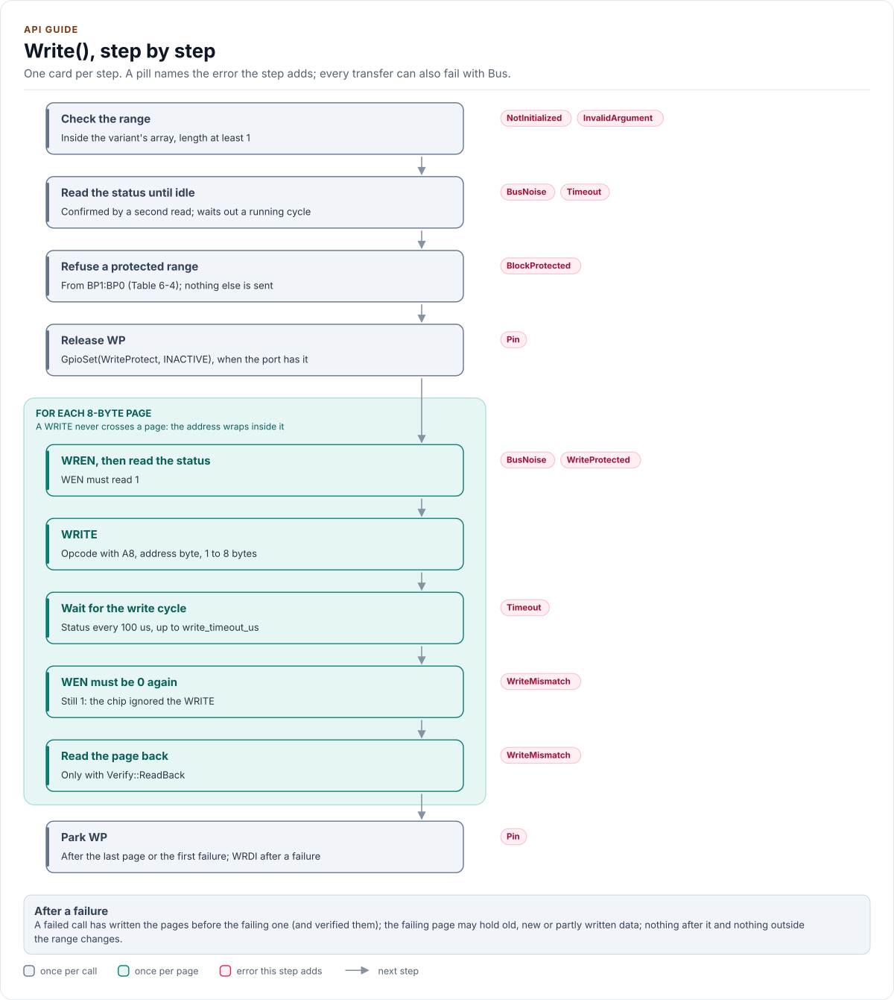

# API guide

The driver's API by task, with code that compiles: start and probe, read, write, protect, use it from a handler,
and handle errors.

<!-- generated: datasheet-refs -->
??? abstract "Datasheet sections this page relies on"

    From Microchip (Atmel) Atmel-8707 F:

    - Write enable latch, WREN and WRDI: 6 Functional Description, Write Enable (WREN), Write Disable (WRDI), [p. 8](https://ww1.microchip.com/downloads/en/DeviceDoc/Atmel-8707-SEEPROM-AT25010B-020B-040B-Datasheet.pdf#page=8)
    - Block write protection (BP1, BP0): 6 Functional Description, Write Status Register (WRSR), Table 6-4, [p. 9](https://ww1.microchip.com/downloads/en/DeviceDoc/Atmel-8707-SEEPROM-AT25010B-020B-040B-Datasheet.pdf#page=9)
    - Sequential read and roll-over: 6 Functional Description, Read Sequence (READ), [p. 9](https://ww1.microchip.com/downloads/en/DeviceDoc/Atmel-8707-SEEPROM-AT25010B-020B-040B-Datasheet.pdf#page=9)
    - Page write, the page wrap and the self-timed write cycle: 6 Functional Description, Write Sequence (WRITE), [p. 9](https://ww1.microchip.com/downloads/en/DeviceDoc/Atmel-8707-SEEPROM-AT25010B-020B-040B-Datasheet.pdf#page=9)

    All of them, with the driver API for each: [Datasheet map](datasheet.md).
<!-- /generated -->

## The shape of the API

| Group | Calls |
| --- | --- |
| Lifecycle | `EnsureInitialized()`, `IsInitialized()`, `Deinitialize()` |
| Configuration | `ApplyConfig()`, `GetConfig()`, `GetCapacityBytes()` |
| Memory | `Read()`, `Write()` |
| Status and protection | `ReadStatus()`, `GetBlockProtection()`, `SetBlockProtection()` |
| Diagnostics | `ReadRawStatus()`, `GetLastStatusByte()` |
| Free functions | `Validate()`, `CapacityBytes()`, `ProtectedFrom()`, `ToString()`, `GetDriverVersion()` |

Every call that touches the chip returns `Result<T>`: check `ok()` (or the `bool` conversion) and read `value`, or
read `error`. `Result` is `[[nodiscard]]`, so an unchecked call is a compiler warning. A failed call's `value` is
`T{}`.

## Start and probe

```cpp
--8<-- "tests/docs/api_tasks.cpp:lifecycle"
```

The constructor stores the port and the configuration and does no I/O. `EnsureInitialized()` is the one way to
start: it brings the bus up, parks WP and runs the identity check ([Contract](contract.md#the-identity-check)):
the status read until idle and confirmed, then the write enable toggle. It writes nothing to the array.

Once it has succeeded, `EnsureInitialized()` returns `Ok` at once with no I/O. After a failure the driver stays
uninitialised and the next call starts again. Every other call returns `NotInitialized` and sends nothing until then.
`GetLastStatusByte()` keeps the last status byte read, by any call, for a log line: 0xFF, 0x05 and 0x00 say
different things ([Troubleshooting](troubleshooting.md)). `ReadRawStatus()` is the single-shot raw access: one RDSR,
no wait, no retry, no check of the byte; RDSR has no side effect on the chip, so it is safe at any time, during a
write cycle too (it then reads 0xFF).

To probe again, for example on every attach of a removable module, `Deinitialize()` (WRDI, WP parked) and then
`EnsureInitialized()`:

```cpp
--8<-- "tests/docs/api_tasks.cpp:reprobe"
```

## Read

```cpp
--8<-- "tests/docs/api_tasks.cpp:read-image"
```

`Read(address, out)` reads `out.size()` bytes, any range inside the array; `out` is a `std::span<uint8_t>`, and a
`std::array` or a C array converts to it. It first reads the status, and if a write cycle runs it
waits for it (at most `Config::write_timeout_us`): a busy chip ignores READ. Then it sends READs of at most 16 bytes
(`kReadChunkBytes`, [why 16](architecture.md#transfer-buffers-and-the-read-chunk)), with A8 recomputed for each, each
read once. With `Verify::ReadBack` as the last argument it reads
each chunk twice and compares (`BusNoise`); use it when the data carries no CRC of its own. The chip would roll over to
address 0 at the top; the driver refuses a range past the end instead (`InvalidArgument`). After a failure the buffer is
zeroed.

## Write

<!-- figure: write-path -->
<picture>
  <source media="(prefers-color-scheme: dark)" srcset="diagrams/write-path.dark.svg">
  
</picture>
<!-- /figure -->

```cpp
--8<-- "tests/docs/api_tasks.cpp:write"
```

`Write(address, data)` writes a `std::span<const uint8_t>`, any range inside the array. It refuses a range that
overlaps the protected part before WREN (`BlockProtected`), raises WP through the port's `GpioSet()`, and then, per
8-byte page: WREN, a status read that must show WEN = 1 (`WriteProtected` otherwise), the WRITE, a wait for the write
cycle polled every 100 µs (`Timeout` after `Config::write_timeout_us`), a status that must show WEN = 0 again
(`WriteMismatch` when the chip ignored the WRITE), and with `Verify::ReadBack` as the last argument a read-back
(`WriteMismatch`). WP is parked after, on success and failure.

A 512-byte image is 64 pages, so 64 write cycles: up to 320 ms by the datasheet's maximum, usually less. The call
blocks for all of it. After a failure, the pages before the failing one hold the new data (and were read back, with
`Verify::ReadBack`); the failing page may hold old, new or partly written data; nothing else changed. Writing the
same data again is safe.

## Protect

```cpp
--8<-- "tests/docs/api_tasks.cpp:protect"
```

`SetBlockProtection(level)` writes BP1:BP0 with WRSR (non-volatile, one write cycle) and reads the level back; when
the chip already holds `level` it writes nothing. `GetBlockProtection()` reads it. The protected part is the top
quarter, the top half or all of the array ([Hardware](hardware.md#block-protection)). `ReadStatus()` returns one raw
status read, decoded, without waiting; during a write cycle it says `busy`.

## Use it from a handler

On a board, the driver sits under a handler that owns it, the port and the bus. The driver leaves to the handler
what it cannot know:

- **When to probe.** Never from a static constructor or at boot: an unplugged module leaves MISO floating, and the
  bus may be shared. Construct the driver at boot if you like (it does no I/O), and call `EnsureInitialized()` from
  the attach path. On each attach, probe again with `Deinitialize()` then `EnsureInitialized()`.
- **The shared bus.** The driver takes no lock and never configures the bus. Take the bus lock in the handler (or
  the port) around each driver call, and pause other traffic on the bus for the call's duration. A read of the
  whole image is 34 transfers (66 with `Verify::ReadBack`); a full write holds the bus through 64 write cycles, so
  release the lock between pages if another device cannot wait that long: split the write into page-sized calls.
- **WP.** Give the port a `GpioSet()` for the WP pin and let the driver drive it: high only for a write, a
  block-protection change and the identity check, low after. Do not release WP in the handler around reads; nothing
  needs it. On a board with WP tied low, set `Config::check_write_enable = false` and accept the weaker check.
- **Write policy.** The driver writes when asked; which firmware may write, and when, is the handler's decision.
- **Locks and time.** The handler serialises the calls. A write blocks for its write cycles (about 5 ms per page at
  most) and polls the status every 100 µs through `DelayUs()`: implement `DelayUs()` with a sleep on an RTOS so the
  wait yields.
- **Retries.** The driver never retries. What to do on each error:

| Error | In the probe | In a read | In a write |
| --- | --- | --- | --- |
| `NoDevice` | Module absent: report it, probe again on the next attach | | |
| `DeviceIdMismatch` | Not an AT25xxxB, MISO stuck low, or WP not reaching the chip: report, do not use | | |
| `BusNoise` | Contention on MISO: retry once, then report | Retry the read once | Retry the call once (rewriting is safe) |
| `Timeout` | | The module was unplugged, or a cycle never ends: probe again | Same |
| `WriteProtected` | | | WP is low: check the pin and the board |
| `BlockProtected` | | | Lower the protection first, or write elsewhere |
| `WriteMismatch` | | | Retry once; again means a worn or failing part |
| `Bus` | The port failed: check the bus, then probe again | Same | Same, then read back before trusting the data |
| `Pin` | The WP pin hook failed: check the GPIO, then probe again | | Same; WP may be left released, so read back |

## Handle errors

```cpp
--8<-- "tests/docs/api_tasks.cpp:errors"
```

| Signal | Meaning | What to do |
| --- | --- | --- |
| `Error::NoDevice` | At start-up the status read 0xFF throughout: nothing drives MISO | Module plugged in? CS, VCC, SO wiring; HOLD tied high |
| `Error::DeviceIdMismatch` | At start-up the bus answered, but not like an AT25xxxB | 0x05: SI shorted to SO. 0x00: MISO stuck low, or WP not reaching pin 3 |
| `Error::BusNoise` | Two reads disagreed, or a status byte no chip sends | Another device drives MISO; lower the clock; shorten the wires |
| `Error::Timeout` | After the start, the status stayed 0xFF longer than the timeout | Module unplugged since the start, or a failing part: probe again |
| `Error::WriteProtected` | WREN did not set WEN | WP low: the port's `GpioSet()`, the wiring, or a board that ties it low |
| `Error::BlockProtected` | The range is in the protected part; nothing was written | `SetBlockProtection(BlockProtect::None)` first, if you mean it |
| `Error::WriteMismatch` | The chip did not keep a write, ignored a WRITE, or BP1:BP0 did not take | Retry once; then suspect the part |
| `Error::Bus` | The port failed a transfer or the bus bring-up | Check the port and the wiring; probe again |
| `Error::Pin` | The port's `GpioSet()` could not drive WP | Check the WP GPIO and its configuration in the port |
| `Error::InvalidArgument` | A `Config` field or an argument is out of range; nothing was sent | Fix the value (`Validate()`, `GetCapacityBytes()`) |
| `Error::NotInitialized` | `EnsureInitialized()` has not succeeded | Call it |

`Error::Crc`, `Error::Busy`, `Error::DeviceFault` and `Error::Unsupported` belong to the shared base set but are
never returned by this driver: the chip sends no CRC and reports no fault, every call waits for a write cycle
instead of returning busy, and the driver has no optional feature. Every value, with the calls that return it, is on
the [Contract](contract.md#errors) page. `at25040b::ToString()` names an error for a log.

Next: [Configuration](configuration.md).
