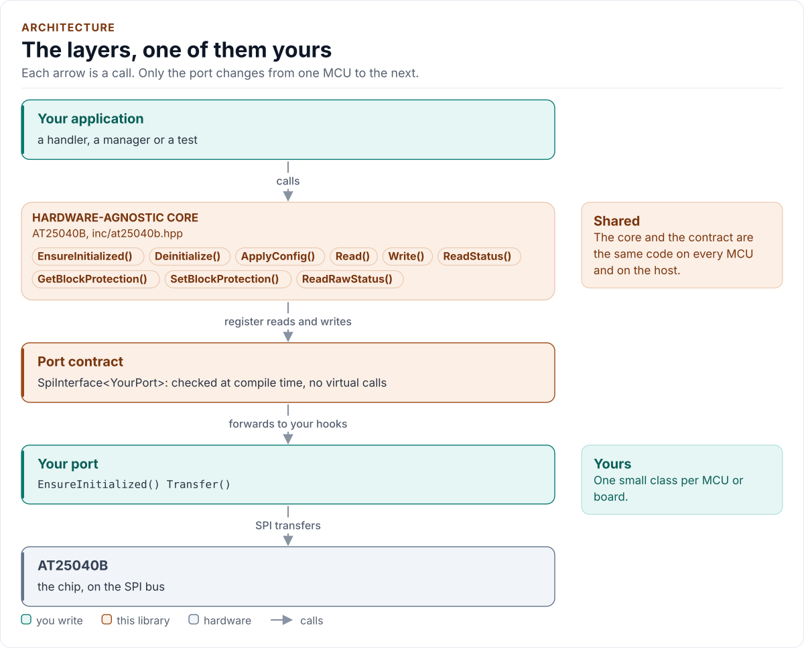
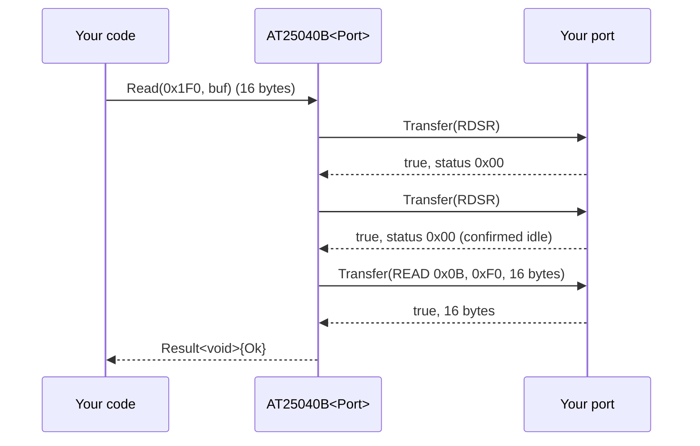

# Architecture

How the driver is built: three layers, one of them yours, and what happens in each when you read or write.

<!-- generated: datasheet-refs -->
??? abstract "Datasheet sections this page relies on"

    From Microchip (Atmel) Atmel-8707 F:

    - Instruction set and A8 in the opcode: 6 Functional Description, Table 6-1, [p. 8](https://ww1.microchip.com/downloads/en/DeviceDoc/Atmel-8707-SEEPROM-AT25010B-020B-040B-Datasheet.pdf#page=8)
    - Sequential read and roll-over: 6 Functional Description, Read Sequence (READ), [p. 9](https://ww1.microchip.com/downloads/en/DeviceDoc/Atmel-8707-SEEPROM-AT25010B-020B-040B-Datasheet.pdf#page=9)
    - Page write, the page wrap and the self-timed write cycle: 6 Functional Description, Write Sequence (WRITE), [p. 9](https://ww1.microchip.com/downloads/en/DeviceDoc/Atmel-8707-SEEPROM-AT25010B-020B-040B-Datasheet.pdf#page=9)

    All of them, with the driver API for each: [Datasheet map](datasheet.md).
<!-- /generated -->

<!-- figure: driver-layers -->
<picture>
  <source media="(prefers-color-scheme: dark)" srcset="diagrams/driver-layers.dark.svg">
  
</picture>
<!-- /figure -->

## Layers

| Layer | Files | Owns |
| --- | --- | --- |
| Core | [`inc/at25040b.hpp`](../inc/at25040b.hpp), [`src/at25040b.ipp`](../src/at25040b.ipp) | Lifecycle, identity check, range checks, page split, write cycle waits, WP handling, verification, errors |
| Types and registers | [`inc/at25040b_types.hpp`](../inc/at25040b_types.hpp), [`inc/at25040b_registers.hpp`](../inc/at25040b_registers.hpp) | `Error`, `Result<T>`, `Variant`, `BlockProtect`, `Status`, `Config`; the opcodes and status bits |
| Port contract | [`inc/at25040b_spi_interface.hpp`](../inc/at25040b_spi_interface.hpp) | The bus requirements, the CRTP base, `CtrlPin` and `GpioSignal`, the `SpiPort` concept, `detail::EepromBus` (one transfer per instruction, A8 in the opcode, the transfer buffers) |
| Compile-time helpers | [`inc/at25040b_detail.hpp`](../inc/at25040b_detail.hpp) | Exact hook probes, `Field<>` for BP1:BP0, enumerator checks; no run-time code |
| Platform port | Your class | Bus bring-up, transfers and delays; optionally the WP pin and logging |
| Kconfig layer | [`inc/at25040b_kconfig.hpp`](../inc/at25040b_kconfig.hpp) | Optional: a `Config` from ESP-IDF menuconfig |

## One read through the layers

A longer read sends one READ every 16 bytes, recomputing A8 for each; `Read(..., Verify::ReadBack)` sends each READ
twice and compares. A write is drawn on the
[API guide](api-guide.md#write).

## Design choices

- **CRTP, not virtual functions.** The port is a template parameter constrained by the `SpiPort` concept, so every
  call is resolved at compile time and a missing hook is a compile error that names it.
- **Optional hooks by named concepts.** `GpioSet` and `Log` are detected by `Has*` concepts in one place, with their
  exact types and `noexcept`; a hook that is declared with another signature is a compile error. A missing
  `DelayUs()` fails to compile, a missing `GpioSet()` leaves WP to the board, a missing `Log()` logs nothing.
- **Spans, bounded at the bus helper.** `Read()` and `Write()` take `std::span`; the bus helper checks every length
  against its buffer before anything is sent (at compile time for a fixed extent), so no caller can overrun it.
- **No I/O in the constructor.** Construction cannot fail and clocks nothing, so the driver can be a static or a
  member of a handler built at boot, before the module is plugged in.
- **Check the bus, not only the chip.** The chip has no ID register and its idle status, 0x00, is also what a dead
  bus reads. So the start-up check uses behaviour a dead bus cannot fake (the write enable latch), status reads are
  confirmed, reads are read twice and writes read back.
- **Wait inside the call.** A write returns after its last write cycle, so the next call finds the chip ready and a
  handler holding a lock knows when the bus is free.
- **One error type.** `Result<T>` carries a value and an `Error`; nothing throws and nothing returns a bare `bool`.
- **No heap, no exceptions, no RTTI, no `std::function`, no `printf`.** The driver is a header-only template with
  no mutable static state.

## Transfer buffers and the read chunk

The port sees only the driver's two transfer buffers, `tx_` and `rx_` of `detail::EepromBus`: members of the driver
object, so they live where the object lives (place it in DMA-capable memory if the port uses DMA), never on a caller's
stack. Their size, `kMaxTransferBytes` = 18, is set by the read chunk, `kReadChunkBytes` = 16. The datasheet sets no
limit on a READ, so 16 is a design choice:

| Chunk | Buffers in the object | Longest CS-low time at 5 MHz | Command overhead |
| --- | --- | --- | --- |
| 8 | 20 bytes | 16 µs | 20 % |
| **16** | **36 bytes** | **29 µs** | **11 %** |
| 32 | 68 bytes | 54 µs | 6 % |
| 512 (whole array) | 1028 bytes | 822 µs | 0.4 % |

16 keeps the buffers small, never holds a shared bus for long, is two whole pages (so a page read back is one READ)
and costs little bus time. It is a compile-time constant, not a `Config` value: the buffers are sized from it and no
value of it changes what the chip does.

## Source map

| You want | Read |
| --- | --- |
| The public API | [`inc/at25040b.hpp`](../inc/at25040b.hpp) |
| How a call is implemented | [`src/at25040b.ipp`](../src/at25040b.ipp) |
| Opcodes and status bits | [`inc/at25040b_registers.hpp`](../inc/at25040b_registers.hpp) |
| The port contract and the instruction framing | [`inc/at25040b_spi_interface.hpp`](../inc/at25040b_spi_interface.hpp) |

Next: [Contract](contract.md).
