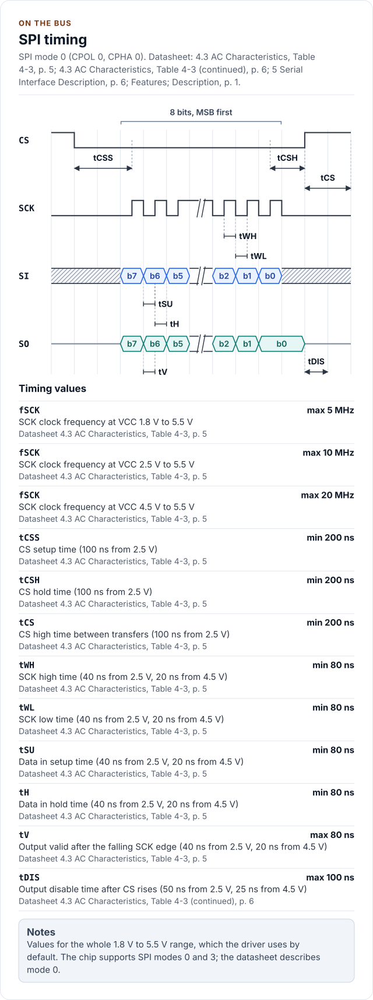
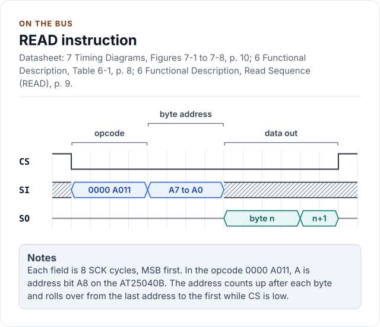
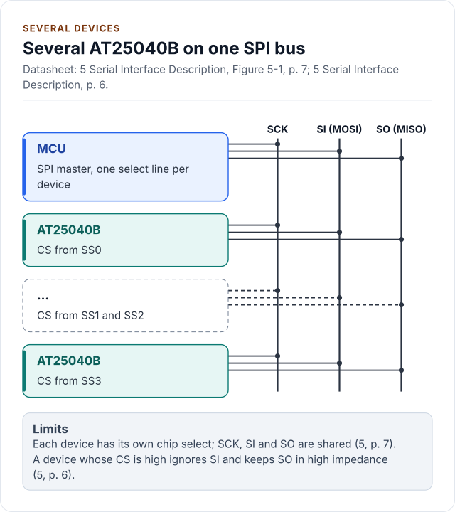

# On the bus

What the AT25040B needs from the SPI bus, signal by signal, with every time and rate taken from the datasheet. The
instruction set is on the [Hardware](hardware.md) page; this page is the waveform under it.

<!-- generated: datasheet-refs -->
??? abstract "Datasheet sections this page relies on"

    From Microchip (Atmel) Atmel-8707 F:

    - Array sizes, page size, write cycle and endurance: Features; Description, [p. 1](https://ww1.microchip.com/downloads/en/DeviceDoc/Atmel-8707-SEEPROM-AT25010B-020B-040B-Datasheet.pdf#page=1)
    - SPI clock, CS timing and the write cycle time: 4.3 AC Characteristics, Table 4-3, [p. 5](https://ww1.microchip.com/downloads/en/DeviceDoc/Atmel-8707-SEEPROM-AT25010B-020B-040B-Datasheet.pdf#page=5)
    - Output disable time (the rest of Table 4-3): 4.3 AC Characteristics, Table 4-3 (continued), [p. 6](https://ww1.microchip.com/downloads/en/DeviceDoc/Atmel-8707-SEEPROM-AT25010B-020B-040B-Datasheet.pdf#page=6)
    - SPI modes, invalid opcodes, HOLD and the WP pin: 5 Serial Interface Description, [p. 6](https://ww1.microchip.com/downloads/en/DeviceDoc/Atmel-8707-SEEPROM-AT25010B-020B-040B-Datasheet.pdf#page=6)
    - Several devices on one SPI bus: 5 Serial Interface Description, Figure 5-1, [p. 7](https://ww1.microchip.com/downloads/en/DeviceDoc/Atmel-8707-SEEPROM-AT25010B-020B-040B-Datasheet.pdf#page=7)
    - Instruction set and A8 in the opcode: 6 Functional Description, Table 6-1, [p. 8](https://ww1.microchip.com/downloads/en/DeviceDoc/Atmel-8707-SEEPROM-AT25010B-020B-040B-Datasheet.pdf#page=8)
    - Sequential read and roll-over: 6 Functional Description, Read Sequence (READ), [p. 9](https://ww1.microchip.com/downloads/en/DeviceDoc/Atmel-8707-SEEPROM-AT25010B-020B-040B-Datasheet.pdf#page=9)
    - Instruction timing: 7 Timing Diagrams, Figures 7-1 to 7-8, [p. 10](https://ww1.microchip.com/downloads/en/DeviceDoc/Atmel-8707-SEEPROM-AT25010B-020B-040B-Datasheet.pdf#page=10)

    All of them, with the driver API for each: [Datasheet map](datasheet.md).
<!-- /generated -->

## SPI timing

The chip reads SI on the rising edge of SCK and changes SO after the falling edge, most significant bit first. It
supports modes 0 and 3; the datasheet draws mode 0, which the driver uses. The limits depend on the supply: the
driver's constants hold for the whole 1.8 V to 5.5 V range (5 MHz), and `BusTimingAt()` gives the faster limits from
2.5 V (10 MHz) and 4.5 V (20 MHz).

<!-- figure: spi-timing -->
<picture>
  <source media="(prefers-color-scheme: dark)" srcset="diagrams/spi-timing.dark.svg">
  
</picture>
<!-- /figure -->

## A READ instruction

Every instruction starts with the falling edge of CS. A READ sends the opcode, whose bit 3 is the ninth address bit
(A8) on the AT25040B, then the low address byte; the chip then shifts out the byte at that address and the next ones
for as long as CS stays low, rolling over from the last address to the first. The driver reads in 16-byte transfers.

<!-- figure: read-transaction -->
<picture>
  <source media="(prefers-color-scheme: dark)" srcset="diagrams/read-transaction.dark.svg">
  
</picture>
<!-- /figure -->

## Several devices

Figure 5-1 of the datasheet puts several devices on one SPI bus: SCK, SI and SO are shared and each device has its
own chip select. A device whose CS is high ignores SI and keeps SO in high impedance.

<!-- figure: spi-topology -->
<picture>
  <source media="(prefers-color-scheme: dark)" srcset="diagrams/spi-topology.dark.svg">
  
</picture>
<!-- /figure -->

## How these figures are made

Each figure is a model in `docs/model/` (`spi-timing.timing.yml`, `read-transaction.timing.yml` and
`spi-topology.topology.yml`) that cites the datasheet section and page of every number; `kokeb-docs figures` draws
it and the build fails on a number without a citation. The values table under each waveform is also written as
`docs/diagrams/<id>.table.html`.
