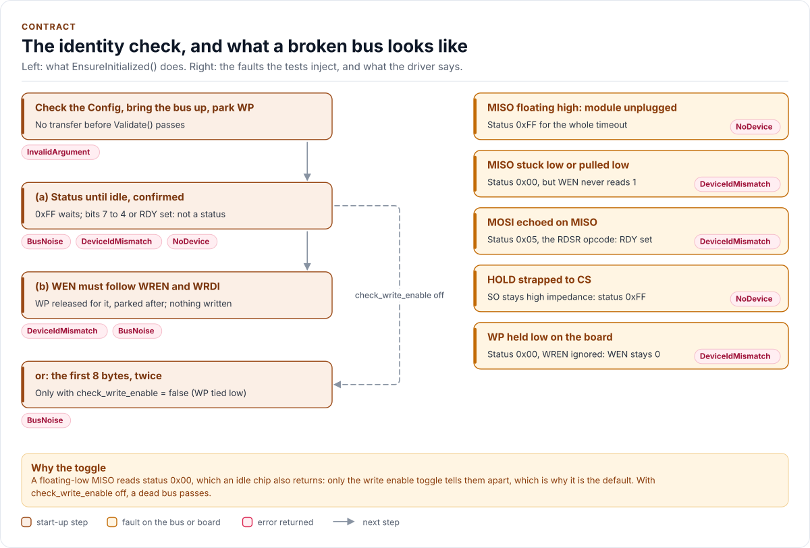

# Contract

What the AT25040B driver promises, what it needs, and the rules a caller follows.

The driver inherits the [Kokeb Labs driver contract](https://github.com/kokeb-labs/.github/blob/main/standards/driver.md);
this page states only what is specific to it. A change to anything here is a breaking change, listed under
**Breaking** in the [changelog](changelog.md).

<!-- generated: datasheet-refs -->
??? abstract "Datasheet sections this page relies on"

    From Microchip (Atmel) Atmel-8707 F:

    - Write enable latch, WREN and WRDI: 6 Functional Description, Write Enable (WREN), Write Disable (WRDI), [p. 8](https://ww1.microchip.com/downloads/en/DeviceDoc/Atmel-8707-SEEPROM-AT25010B-020B-040B-Datasheet.pdf#page=8)
    - Status register, RDY and the all-ones status of a write cycle: 6 Functional Description, Tables 6-2 and 6-3, [p. 8](https://ww1.microchip.com/downloads/en/DeviceDoc/Atmel-8707-SEEPROM-AT25010B-020B-040B-Datasheet.pdf#page=8)
    - Page write, the page wrap and the self-timed write cycle: 6 Functional Description, Write Sequence (WRITE), [p. 9](https://ww1.microchip.com/downloads/en/DeviceDoc/Atmel-8707-SEEPROM-AT25010B-020B-040B-Datasheet.pdf#page=9)

    All of them, with the driver API for each: [Datasheet map](datasheet.md).
<!-- /generated -->

## Promises

- The constructor is `noexcept`, does no I/O and cannot fail. No call clocks the bus before `EnsureInitialized()`,
  so the driver can be constructed statically even where MISO may float.
- `EnsureInitialized()` runs the identity check below and nothing else; it never sends WRITE or WRSR. On any failure
  the driver stays uninitialised, and the next call starts again.
- Every call that touches the chip returns `Error::NotInitialized` before `EnsureInitialized()` succeeds and sends
  nothing. No call starts the chip as a side effect.
- Every port failure propagates: a failed transfer as `Error::Bus`, a failed WP pin write as `Error::Pin`. When a step
  fails and parking WP fails too, the call returns `Pin` (WP may be left released) and logs both. A failed `Read()`
  leaves its buffer zeroed, never partial data.
- Before each array access and after each write the driver reads the status until no write cycle runs (at most
  `Config::write_timeout_us`), and an idle status counts only when a second read gives the same byte. It never
  sends an instruction a busy chip would ignore.
- `Write()` never sends a WRITE that crosses a page, never writes outside the requested range, and refuses a range
  in the block-protected part before it sends WREN. It returns only after the last write cycle has ended.
- `Read()` and `Write()` send only what the datasheet needs, plus the status reads above, unless the call asks for
  more. Verification is chosen per call: with `Verify::ReadBack`, one corrupted transfer never makes `Read()` return
  wrong bytes with `Ok`, and never makes `Write()` return `Ok` for bytes the chip does not hold. With
  `Verify::None`, the default, a corrupted READ reaches the caller (check a CRC over the data), and a WRITE the
  chip ignored is still caught by the WEN check after its write cycle.
- WP is high only during a write, a block-protection change and the identity check, and parked low after each of
  them, on success and on failure. A failure after WREN sends WRDI, so the latch is not left set.
- `SetBlockProtection()` is the only call that sends WRSR, and only when the level changes.
- A missing `DelayUs()` is a compile error; a missing `GpioSet()` leaves WP to the board; a missing `Log()` logs
  nothing. A misdeclared hook is a compile error.
- The driver never retries a call. Retries are the caller's choice ([API guide](api-guide.md#use-it-from-a-handler)).

## The identity check

<!-- figure: identity-check -->
<picture>
  <source media="(prefers-color-scheme: dark)" srcset="diagrams/identity-check.dark.svg">
  
</picture>
<!-- /figure -->

The AT25xxxB family has no ID register, so `EnsureInitialized()` checks behaviour the datasheet guarantees,
strongest test first:

1. **The status, read until idle and confirmed.** Bits 7 to 4 read 0 when no write cycle runs, and every bit reads
   1 during one (Table 6-3). The driver reads the status until it is not 0xFF (a write cycle may still run after an
   MCU reset), for at most `Config::write_timeout_us`, then once more: both reads must be the same idle status.
   0xFF throughout is `NoDevice` (MISO floating high); 0x05 (the RDSR opcode echoed from MOSI) or any byte with bits
   7 to 4 or RDY set is `DeviceIdMismatch`; two different idle bytes are `BusNoise`.
2. **The write enable latch follows WREN and WRDI** (`Config::check_write_enable`, the default). WP is released,
   the latch cleared first if it was already set, then WREN must make WEN read 1 and WRDI must make it read 0, and WP
   is parked again. Nothing is programmed. A MISO stuck low reads 0x00, which passes step 1 like an idle chip, but it
   can never show WEN = 1: WEN is set only by a WREN the chip received with WP high (section 6, "Write Enable";
   Table 6-2), so it proves that a chip, not a line, answers.
3. **Without step 2**, for a board whose WP pin is tied low (the chip then never sets WEN), the first
   `kIdentityReadBytes` (8) are read twice and must match (`BusNoise` otherwise). This is weaker: a dead bus with
   MISO stuck low passes it.

The check cannot tell the part's size, so `Config::variant` is trusted.

## Depends on

| Dependency | Version | Why |
| --- | --- | --- |
| A C++20 compiler | GCC 10, Clang 13 or later | Concepts constrain the port |
| CMake | 3.16 or later | Generates `at25040b_version.h` |
| Your port | | The bus, a delay, optionally the WP pin and logging ([Porting](porting.md)) |

Nothing else: no RTOS, no SDK, no other repository of the org.

## Threading

The driver is not thread-safe and takes no lock. Use each driver object from one task at a time, or guard every
call on it with one mutex; the layer that owns the driver owns that lock, and the bus lock when several chips share a
bus. Nothing may run in an ISR: every call can block for transfers and, for a write, for the write cycles (about
5 ms per page at most, `Config::write_timeout_us` per page in the worst case). Separate objects share no state.

## Timing

| Call | Transfers | Waits |
| --- | --- | --- |
| `EnsureInitialized()` | 6 (8 if the latch was set) | Only while a write cycle runs |
| `Read()` of n bytes | 2 + ceil(n / 16); 2 + 2 x ceil(n / 16) with `Verify::ReadBack` | Only while a write cycle runs |
| `Write()` of p pages | 2 + 5 x p, plus status polls; 2 + 6 x p with `Verify::ReadBack` | Each write cycle, polled every 100 µs |
| `SetBlockProtection()` | 7, plus status polls (2 when the level is already set) | One write cycle |
| `GetBlockProtection()`, `ReadStatus()` | 2, 1 | `GetBlockProtection()` only while a cycle runs |

With `Verify::None` the transfers beyond the datasheet's own sequence are: the second, confirming status read before
a `Read()` or `Write()` and after each write cycle (one corrupted read must not let the driver send a READ or WREN
to a busy chip, which ignores it: found by the fuzzer), and the status read after each WREN (WEN = 1, so WP low is
`WriteProtected` before a WRITE is sent). The WEN = 0 check after a write cycle reuses the last status read.
`Config::check_write_enable` adds nothing to `Read()` or `Write()`: it runs once, in `EnsureInitialized()`.

**Why the status read after each WREN is not opt-in.** The datasheet requires a WREN before every WRITE, and the latch
clears at the end of each write cycle, so a WREN per page is part of the datasheet's sequence. The status read after it
is one more short transfer. Each page then waits for its self-timed write cycle, up to 5 ms, which makes that read a
small fraction of the page's time. In return a chip that did not take the WREN (WP held low, a broken MOSI) is
reported as `WriteProtected` before the WRITE is sent, instead of a write that silently did nothing. EEPROM writes
are not a timing-critical path, so this check stays on every page. Opt-in verification (`Verify::ReadBack`) is for
checks that cost a read of the data itself.

## Errors

`at25040b::Error` inside `at25040b::Result<T>`. Values 0 to 9 are the shared base set; this driver returns six of
them, plus six chip-specific values.

| `Error` | Value | Returned when |
| --- | --- | --- |
| `Ok` | 0 | The call succeeded |
| `NotInitialized` | 1 | `EnsureInitialized()` has not succeeded, or `Deinitialize()` ran since |
| `InvalidArgument` | 2 | A `Config` field fails `Validate()`, an address range leaves the array, an empty range, or a block-protection level that is not one; nothing was sent |
| `Bus` | 3 | A transfer, or the port's bus bring-up, failed |
| `Timeout` | 4 | After the start, the status read busy for longer than `Config::write_timeout_us`: a write cycle that does not end, or the module was unplugged since |
| `DeviceIdMismatch` | 5 | At start-up, a status byte that is neither idle nor busy, or the latch did not follow WREN and WRDI |
| `Crc` | 6 | Never returned: the chip sends no CRC |
| `Busy` | 7 | Never returned: every call waits for a running write cycle instead |
| `DeviceFault` | 8 | Never returned: the chip reports no faults |
| `Unsupported` | 9 | Never returned: the driver has no optional feature |
| `NoDevice` | 16 | At start-up, the status read 0xFF for the whole timeout: nothing drives MISO |
| `BusNoise` | 17 | Two reads of the same thing differed, or after the start a status byte was neither idle nor busy |
| `WriteProtected` | 18 | WREN did not set WEN: WP is low, or the WREN frame was lost; nothing was written |
| `BlockProtected` | 19 | The range lies in the block-protected part; only the status was read |
| `WriteMismatch` | 20 | The read-back differed, the latch was still set after a WRITE (the chip ignored it), or BP1:BP0 did not take |
| `Pin` | 21 | The port's `GpioSet()` could not release or park WP (handbook KB-CPP-047) |

The [API guide](api-guide.md#handle-errors) says what to do about each.

## Memory

No heap, no exceptions, no RTTI, no `std::function`, no `std::string`, no `printf` and no static mutable state. A
driver object holds a reference to the port, its two 18-byte transfer buffers (the only memory the port sees), a
`Config`, the last status byte and a flag: about 56 bytes on a 32-bit MCU. Stack use is small and fixed: a 16-byte
compare buffer in `Read()` with `Verify::ReadBack`, an 8-byte one in `Write()`.

## Platform

Platform-free: the same code runs on any target with a C++20 compiler, including the host tests. The ESP-IDF port
in [`examples/esp32`](examples.md) is an example, not part of the driver.

## Deviations from the standard

| Rule | Deviation | Why |
| --- | --- | --- |
| A chip-ID check at start-up | Replaced by the behaviour check above | The chip has no ID register |
| A reset at start-up | None | The chip has no reset; it powers up with the latch clear (section 6, "Write Enable") |
| `Config{}` equals the chip's reset state | `Config` describes the board (variant, WP wiring, checks), not chip registers | The only setting, BP1:BP0, is non-volatile and is never written by `EnsureInitialized()` |
