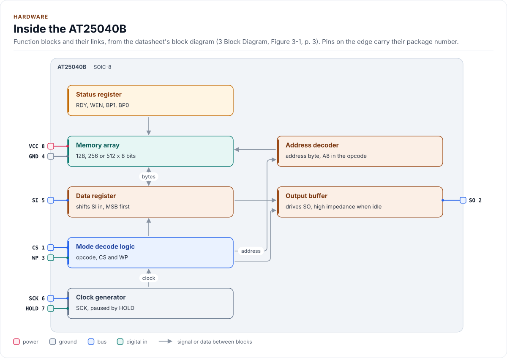
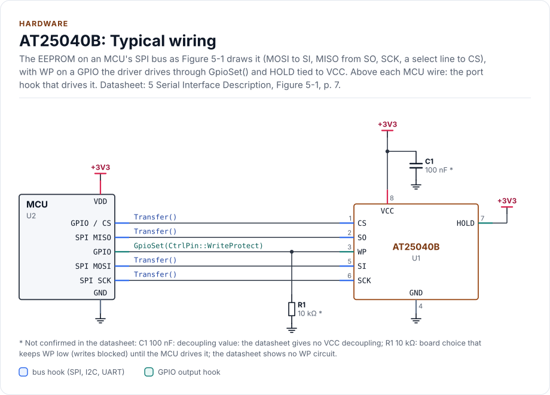
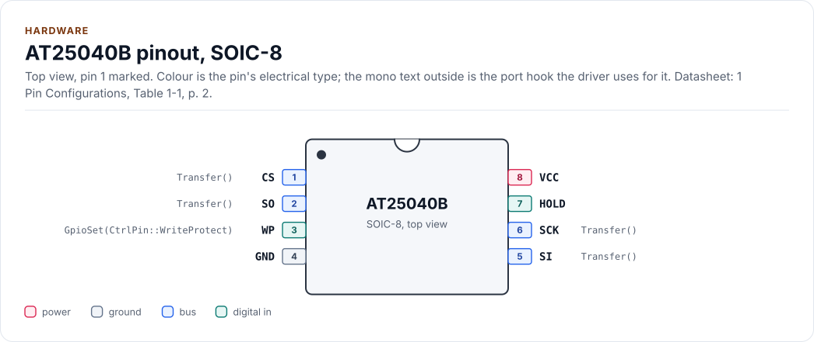
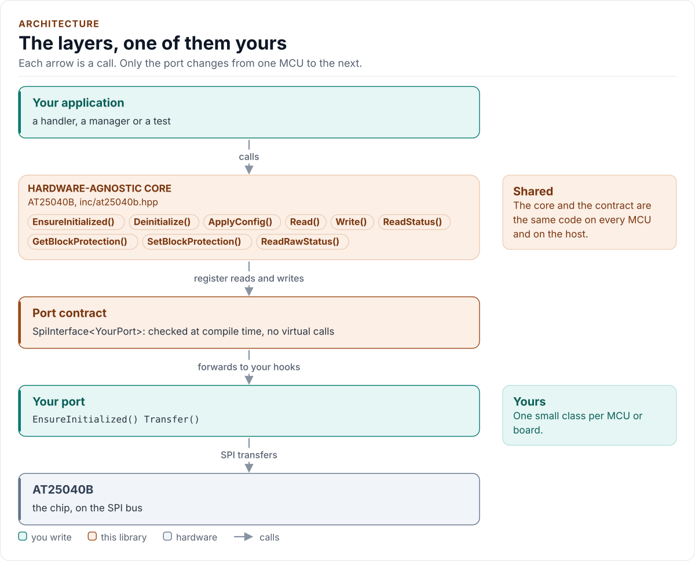
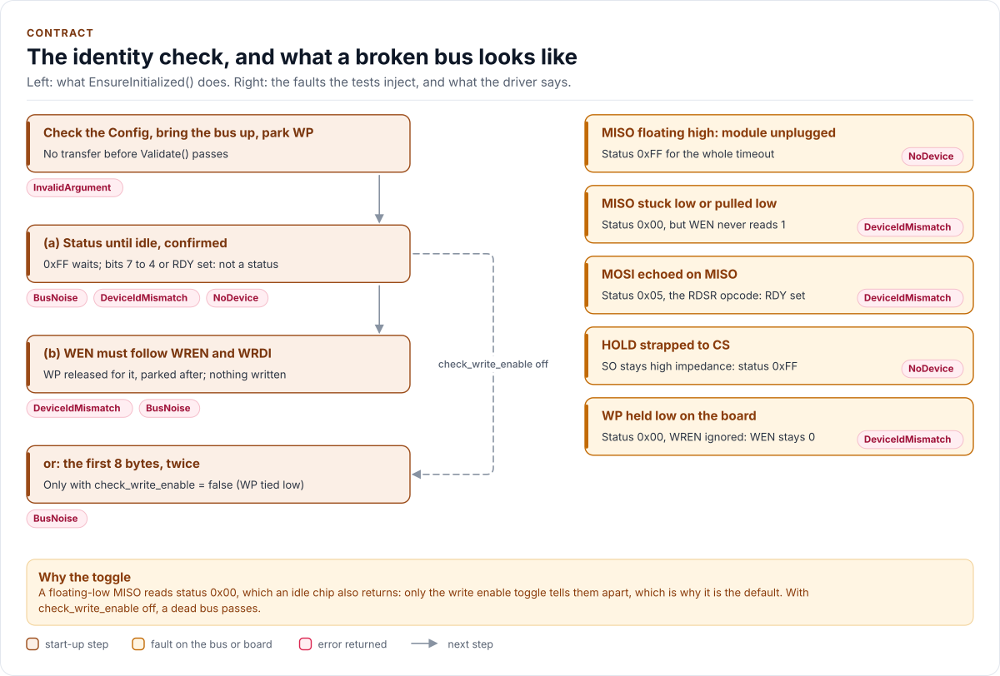
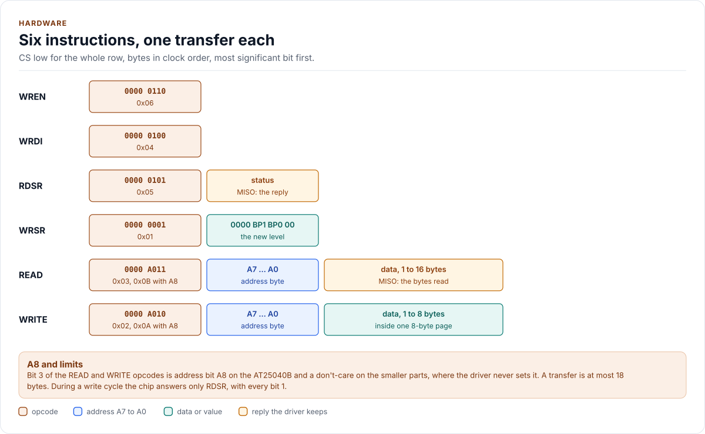
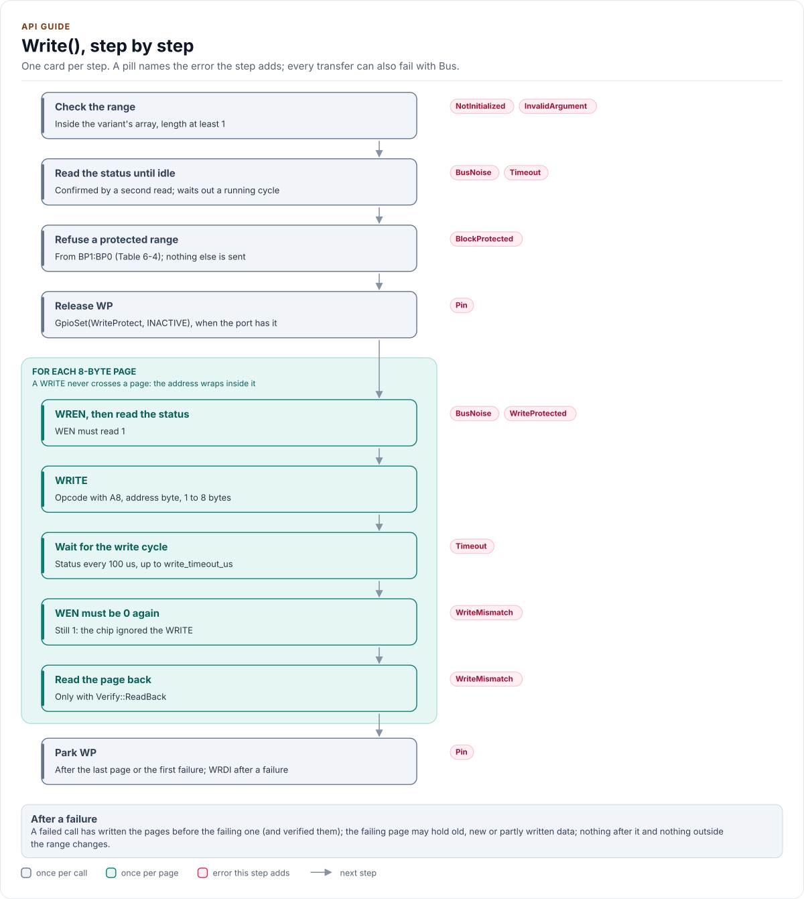

# Figures

<!-- Written by kokeb-docs figures from docs/diagrams/figures/*.py. Do not edit by hand. -->

Every figure on this site is drawn by a Python module from facts extracted from the code, so it is rebuilt,
not redrawn, when the code changes. CI runs `kokeb-docs figures --check` and fails when a
committed figure no longer matches the code. Each figure below lists the files it is drawn from.

## Inside the AT25040B

<!-- figure: chip-blocks -->
<picture>
  <source media="(prefers-color-scheme: dark)" srcset="chip-blocks.dark.svg">
  
</picture>
<!-- /figure -->

Hardware description: [`docs/hardware.yml`](../hardware.yml)

Drawn from:

- [`docs/hardware.yml`](../hardware.yml)
- [`inc/at25040b_spi_interface.hpp`](../../inc/at25040b_spi_interface.hpp)

## AT25040B: Typical wiring

<!-- figure: chip-circuit-typical -->
<picture>
  <source media="(prefers-color-scheme: dark)" srcset="chip-circuit-typical.dark.svg">
  
</picture>
<!-- /figure -->

Hardware description: [`docs/hardware.yml`](../hardware.yml)

Drawn from:

- [`docs/hardware.yml`](../hardware.yml)
- [`inc/at25040b_spi_interface.hpp`](../../inc/at25040b_spi_interface.hpp)

## AT25040B pinout, SOIC-8

<!-- figure: chip-pinout -->
<picture>
  <source media="(prefers-color-scheme: dark)" srcset="chip-pinout.dark.svg">
  
</picture>
<!-- /figure -->

Hardware description: [`docs/hardware.yml`](../hardware.yml)

Drawn from:

- [`docs/hardware.yml`](../hardware.yml)
- [`inc/at25040b_spi_interface.hpp`](../../inc/at25040b_spi_interface.hpp)

## The layers, one of them yours

<!-- figure: driver-layers -->
<picture>
  <source media="(prefers-color-scheme: dark)" srcset="driver-layers.dark.svg">
  
</picture>
<!-- /figure -->

Figure module: [`docs/diagrams/figures/driver-layers.py`](../../docs/diagrams/figures/driver-layers.py)

Drawn from:

- `public calls` in [`inc/at25040b.hpp`](../../inc/at25040b.hpp)
- `SpiInterface` in [`inc/at25040b_spi_interface.hpp`](../../inc/at25040b_spi_interface.hpp)

## The identity check, and what a broken bus looks like

<!-- figure: identity-check -->
<picture>
  <source media="(prefers-color-scheme: dark)" srcset="identity-check.dark.svg">
  
</picture>
<!-- /figure -->

Figure module: [`docs/diagrams/figures/identity-check.py`](../../docs/diagrams/figures/identity-check.py)

Drawn from:

- `initialize` in [`src/at25040b.ipp`](../../src/at25040b.ipp)
- `checkWriteEnableToggle` in [`src/at25040b.ipp`](../../src/at25040b.ipp)
- `checkStableHead` in [`src/at25040b.ipp`](../../src/at25040b.ipp)
- `waitIdle` in [`src/at25040b.ipp`](../../src/at25040b.ipp)
- `start-up fault tests` in [`tests/test_at25040b.cpp`](../../tests/test_at25040b.cpp)

## Six instructions, one transfer each

<!-- figure: instruction-frames -->
<picture>
  <source media="(prefers-color-scheme: dark)" srcset="instruction-frames.dark.svg">
  
</picture>
<!-- /figure -->

Figure module: [`docs/diagrams/figures/instruction-frames.py`](../../docs/diagrams/figures/instruction-frames.py)

Drawn from:

- `opcodes` in [`inc/at25040b_registers.hpp`](../../inc/at25040b_registers.hpp)
- `detail::EepromBus` in [`inc/at25040b_spi_interface.hpp`](../../inc/at25040b_spi_interface.hpp)
- `kReadChunkBytes` in [`inc/at25040b_types.hpp`](../../inc/at25040b_types.hpp)

## Write(), step by step

<!-- figure: write-path -->
<picture>
  <source media="(prefers-color-scheme: dark)" srcset="write-path.dark.svg">
  
</picture>
<!-- /figure -->

Figure module: [`docs/diagrams/figures/write-path.py`](../../docs/diagrams/figures/write-path.py)

Drawn from:

- `Write` in [`src/at25040b.ipp`](../../src/at25040b.ipp)
- `writeRange` in [`src/at25040b.ipp`](../../src/at25040b.ipp)
- `writePage` in [`src/at25040b.ipp`](../../src/at25040b.ipp)
- `enableWrite` in [`src/at25040b.ipp`](../../src/at25040b.ipp)
- `finishWriteCycle` in [`src/at25040b.ipp`](../../src/at25040b.ipp)
- `waitIdle` in [`src/at25040b.ipp`](../../src/at25040b.ipp)
- `withWriteAccess` in [`src/at25040b.ipp`](../../src/at25040b.ipp)
