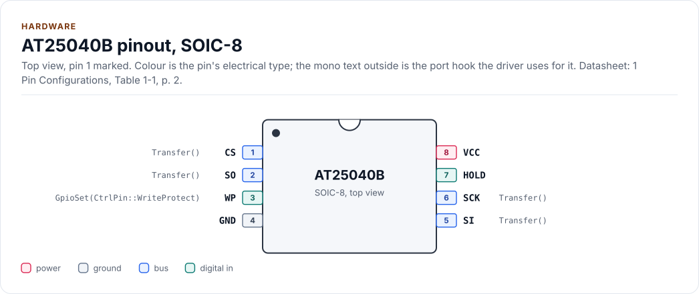
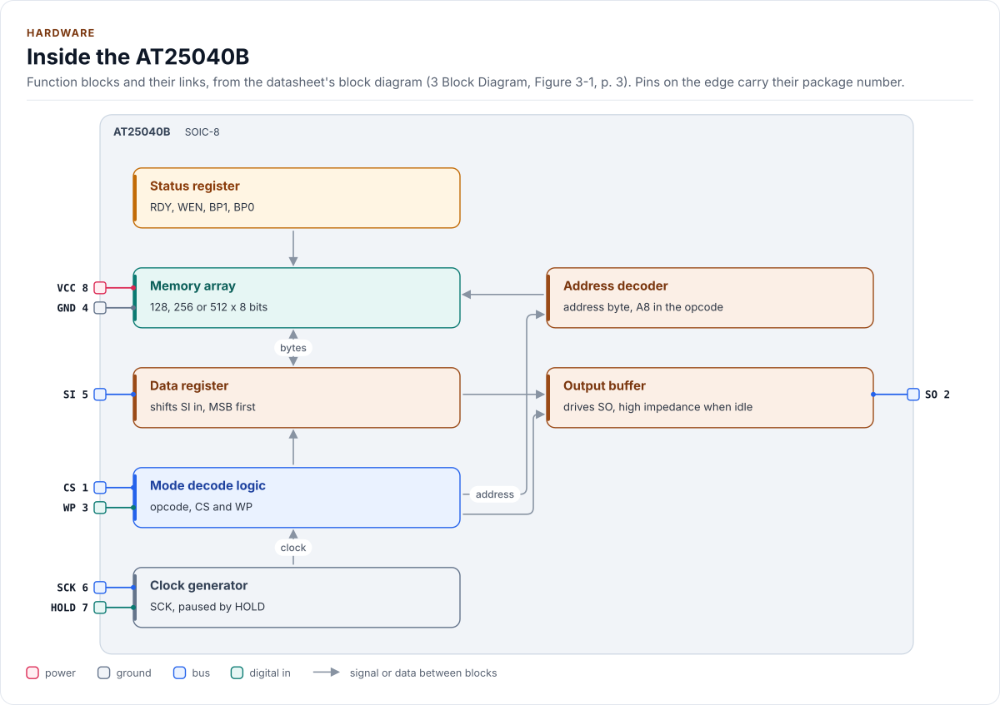
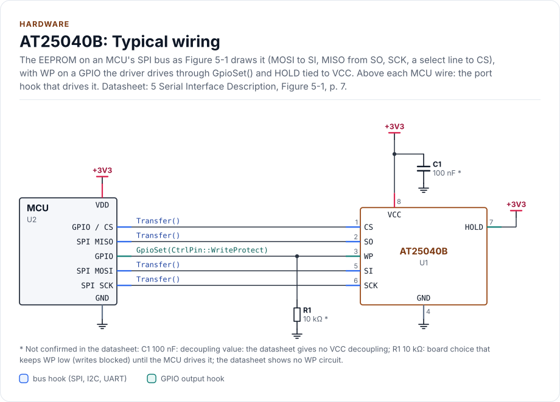
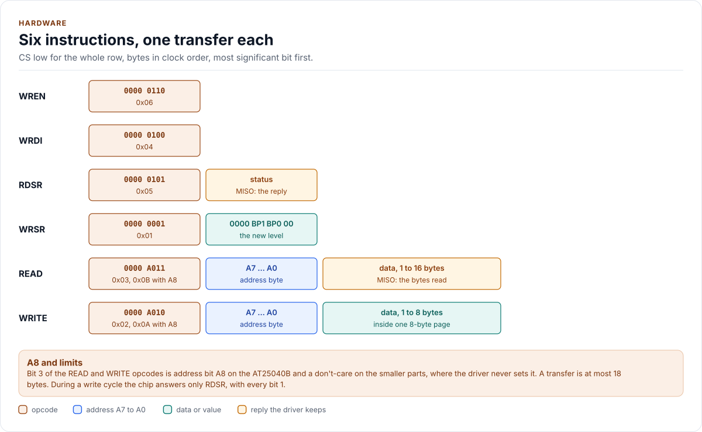

# Hardware

The AT25010B, AT25020B and AT25040B: pins, bus settings, instructions, status register, protection and power, as
the driver uses them. Values are from the datasheet; when your schematic disagrees on pin numbers, the schematic
wins.

<!-- generated: datasheet-refs -->
??? abstract "Datasheet sections this page relies on"

    From Microchip (Atmel) Atmel-8707 F:

    - Array sizes, page size, write cycle and endurance: Features; Description, [p. 1](https://ww1.microchip.com/downloads/en/DeviceDoc/Atmel-8707-SEEPROM-AT25010B-020B-040B-Datasheet.pdf#page=1)
    - Pins and packages: 1 Pin Configurations, Table 1-1, [p. 2](https://ww1.microchip.com/downloads/en/DeviceDoc/Atmel-8707-SEEPROM-AT25010B-020B-040B-Datasheet.pdf#page=2)
    - Supply voltage and current: 4.2 DC Characteristics, Table 4-2, [p. 4](https://ww1.microchip.com/downloads/en/DeviceDoc/Atmel-8707-SEEPROM-AT25010B-020B-040B-Datasheet.pdf#page=4)
    - SPI clock, CS timing and the write cycle time: 4.3 AC Characteristics, Table 4-3, [p. 5](https://ww1.microchip.com/downloads/en/DeviceDoc/Atmel-8707-SEEPROM-AT25010B-020B-040B-Datasheet.pdf#page=5)
    - SPI modes, invalid opcodes, HOLD and the WP pin: 5 Serial Interface Description, [p. 6](https://ww1.microchip.com/downloads/en/DeviceDoc/Atmel-8707-SEEPROM-AT25010B-020B-040B-Datasheet.pdf#page=6)
    - Instruction set and A8 in the opcode: 6 Functional Description, Table 6-1, [p. 8](https://ww1.microchip.com/downloads/en/DeviceDoc/Atmel-8707-SEEPROM-AT25010B-020B-040B-Datasheet.pdf#page=8)
    - Status register, RDY and the all-ones status of a write cycle: 6 Functional Description, Tables 6-2 and 6-3, [p. 8](https://ww1.microchip.com/downloads/en/DeviceDoc/Atmel-8707-SEEPROM-AT25010B-020B-040B-Datasheet.pdf#page=8)
    - Block write protection (BP1, BP0): 6 Functional Description, Write Status Register (WRSR), Table 6-4, [p. 9](https://ww1.microchip.com/downloads/en/DeviceDoc/Atmel-8707-SEEPROM-AT25010B-020B-040B-Datasheet.pdf#page=9)
    - Instruction timing: 7 Timing Diagrams, Figures 7-1 to 7-8, [p. 10](https://ww1.microchip.com/downloads/en/DeviceDoc/Atmel-8707-SEEPROM-AT25010B-020B-040B-Datasheet.pdf#page=10)
    - Ordering codes and part markings: 8 Ordering Code Detail; 9 Part Markings, [p. 13](https://ww1.microchip.com/downloads/en/DeviceDoc/Atmel-8707-SEEPROM-AT25010B-020B-040B-Datasheet.pdf#page=13)

    All of them, with the driver API for each: [Datasheet map](datasheet.md).
<!-- /generated -->

## Pins

The 8-lead SOIC and TSSOP use the pin numbers below; the UDFN, XDFN and VFBGA number the same functions 1 to 8
(datasheet section 1, Table 1-1). The pinout, the block diagram, the circuit and the two tables on this page are
drawn from [`docs/hardware.yml`](hardware.yml).

<!-- figure: chip-pinout -->
<picture>
  <source media="(prefers-color-scheme: dark)" srcset="diagrams/chip-pinout.dark.svg">
  
</picture>
<!-- /figure -->

<!-- generated: chip-pins -->
SOIC-8, 8 pins (1 Pin Configurations, Table 1-1, [p. 2](https://ww1.microchip.com/downloads/en/DeviceDoc/Atmel-8707-SEEPROM-AT25010B-020B-040B-Datasheet.pdf#page=2)).

| Pin | Name | Type (domain) | Function | Driver hook | If unused | Datasheet |
| --- | --- | --- | --- | --- | --- | --- |
| 1 | `CS` | bus (VCC) | Chip select, active low; every instruction starts on its falling edge | `Transfer()` | - | 5, [p. 6](https://ww1.microchip.com/downloads/en/DeviceDoc/Atmel-8707-SEEPROM-AT25010B-020B-040B-Datasheet.pdf#page=6) |
| 2 | `SO` | bus (VCC) | Serial data out (MISO); high impedance while CS is high or HOLD is low | `Transfer()` | - | 5, [p. 6](https://ww1.microchip.com/downloads/en/DeviceDoc/Atmel-8707-SEEPROM-AT25010B-020B-040B-Datasheet.pdf#page=6) |
| 3 | `WP` | digital in (VCC) | Write protect, active low: low inhibits every write; high allows reads and writes | `GpioSet(CtrlPin::WriteProtect)` | Tie to VCC | 5, [p. 6](https://ww1.microchip.com/downloads/en/DeviceDoc/Atmel-8707-SEEPROM-AT25010B-020B-040B-Datasheet.pdf#page=6) |
| 4 | `GND` | ground | Ground | - | - | 1, [p. 2](https://ww1.microchip.com/downloads/en/DeviceDoc/Atmel-8707-SEEPROM-AT25010B-020B-040B-Datasheet.pdf#page=2) |
| 5 | `SI` | bus (VCC) | Serial data in (MOSI): opcode, address and data, MSB first | `Transfer()` | - | 5, [p. 6](https://ww1.microchip.com/downloads/en/DeviceDoc/Atmel-8707-SEEPROM-AT25010B-020B-040B-Datasheet.pdf#page=6) |
| 6 | `SCK` | bus (VCC) | Serial clock: 20 MHz max from VCC 4.5 V, 10 MHz from 2.5 V, 5 MHz from 1.8 V | `Transfer()` | - | 4.3, [p. 5](https://ww1.microchip.com/downloads/en/DeviceDoc/Atmel-8707-SEEPROM-AT25010B-020B-040B-Datasheet.pdf#page=5) |
| 7 | `HOLD` | digital in (VCC) | Hold, active low: pauses a transfer while SCK is low; the driver never uses it | - | Tie to VCC | 5, [p. 6](https://ww1.microchip.com/downloads/en/DeviceDoc/Atmel-8707-SEEPROM-AT25010B-020B-040B-Datasheet.pdf#page=6) |
| 8 | `VCC` | power (VCC) | Supply, 1.8 V to 5.5 V | - | - | 4.2, [p. 4](https://ww1.microchip.com/downloads/en/DeviceDoc/Atmel-8707-SEEPROM-AT25010B-020B-040B-Datasheet.pdf#page=4) |

Source of this table and of the chip figures: [`docs/hardware.yml`](hardware.yml).
<!-- /generated -->

**HOLD.** HOLD low while SCK is low pauses the chip and leaves SO in high impedance (section 5). Strapped to CS, it
is low for every instruction, so every status read returns MISO's pull-up level: the driver sees no chip
(`NoDevice`).

**WP.** With WP low the chip ignores WREN, so no write starts; WRDI still works. WP going low while CS is low
interrupts a write that has not started its cycle; once the cycle runs, WP has no effect (section 5). The driver
raises WP (through `GpioSet()`) only for a write, a block-protection change and the identity check, and parks it low
after, whatever happened.

## Inside the chip

<!-- figure: chip-blocks -->
<picture>
  <source media="(prefers-color-scheme: dark)" srcset="diagrams/chip-blocks.dark.svg">
  
</picture>
<!-- /figure -->

## Connecting it

Figure 5-1 draws only the four SPI lines. The circuit adds what the driver and the chip need around them: WP on a
GPIO with a pull-down that keeps writes blocked until the MCU drives it, HOLD tied to VCC, and a decoupling
capacitor. The datasheet gives neither value; both are marked `*`.

<!-- figure: chip-circuit-typical -->
<picture>
  <source media="(prefers-color-scheme: dark)" srcset="diagrams/chip-circuit-typical.dark.svg">
  
</picture>
<!-- /figure -->

<!-- generated: chip-parts -->
| Part | Kind | Value | Connects | Datasheet |
| --- | --- | --- | --- | --- |
| U2 | MCU | - | VDD: +3V3, GND: GND, SCK: SCK, MOSI: SI, MISO: SO, CS: CS, WP: WP | 5, [p. 7](https://ww1.microchip.com/downloads/en/DeviceDoc/Atmel-8707-SEEPROM-AT25010B-020B-040B-Datasheet.pdf#page=7) |
| C1 | capacitor | 100 nF (not confirmed: decoupling value: the datasheet gives no VCC decoupling) | +3V3, GND | 5, [p. 7](https://ww1.microchip.com/downloads/en/DeviceDoc/Atmel-8707-SEEPROM-AT25010B-020B-040B-Datasheet.pdf#page=7) |
| R1 | resistor | 10 kΩ (not confirmed: board choice that keeps WP low (writes blocked) until the MCU drives it; the datasheet shows no WP circuit) | GND, WP | 5, [p. 7](https://ww1.microchip.com/downloads/en/DeviceDoc/Atmel-8707-SEEPROM-AT25010B-020B-040B-Datasheet.pdf#page=7) |

Export a circuit for a schematic or PCB tool: `kokeb-docs hardware --kicad-netlist OUT.net --circuit typical`.
<!-- /generated -->

## Bus settings

| Setting | Value |
| --- | --- |
| Mode | 0 or 3, MSB first (the datasheet draws mode 0) |
| fSCK max | 20 MHz (VCC 4.5 V to 5.5 V), 10 MHz (2.5 V to 5.5 V), 5 MHz (1.8 V to 5.5 V) |
| tCSS, tCSH, tCS min | 100 ns (VCC from 2.5 V), 200 ns (from 1.8 V) |
| Frame | Opcode, then an address byte (READ, WRITE) or one byte (RDSR, WRSR), then data; no dummy cycles |
| Longest transfer from the driver | 18 bytes (`kMaxTransferBytes`): READ opcode, address and 16 data bytes |
| tWC max | 5 ms, self-timed, from the rising edge of CS after a WRITE or WRSR |

The driver states these as `constexpr` values in
[`inc/at25040b_spi_interface.hpp`](../inc/at25040b_spi_interface.hpp) (`kSpiMode`, `kMaxClockHz`, `BusTimingAt()`, ...);
the [Porting](porting.md#bus-requirements) page lists them.

tCSS is CS setup before the first clock, tCSH CS hold after the last, and tCS the
time CS stays high between instructions (Table 4-3). The datasheet gives no power-up time.

## Instructions

<!-- figure: instruction-frames -->
<picture>
  <source media="(prefers-color-scheme: dark)" srcset="diagrams/instruction-frames.dark.svg">
  
</picture>
<!-- /figure -->

| Instruction | Opcode | What it does | Used by |
| --- | --- | --- | --- |
| WREN | `0x06` | Sets the write enable latch; WP must be high | Every write, `SetBlockProtection()`, the identity check |
| WRDI | `0x04` | Clears the latch, whatever WP does | The identity check, `Deinitialize()`, after a failed write |
| RDSR | `0x05` | Reads the status; the only instruction a busy chip answers | Every call |
| WRSR | `0x01` | Writes BP1 and BP0: non-volatile, takes a write cycle | `SetBlockProtection()` |
| READ | `0x03`, `0x0B` with A8 | Address byte, then data; the address counts up and rolls over at the top | `Read()`, write verification |
| WRITE | `0x02`, `0x0A` with A8 | Address byte, then 1 to 8 data bytes in one page | `Write()` |

Bit 3 of READ and WRITE carries address bit A8 on the AT25040B only (Table 6-1, note 1); on the smaller parts the
driver never sets it, because it checks every address against the configured variant. An invalid opcode leaves SO
in high impedance until the next CS falling edge (section 5).

## Status register

| Bit | Name | Meaning |
| --- | --- | --- |
| 0 | RDY | 1 while a write cycle runs |
| 1 | WEN | 1 when the write enable latch is set |
| 2 | BP0 | Block protection, low bit |
| 3 | BP1 | Block protection, high bit |
| 7 to 4 | | 0 when no write cycle runs |

During a write cycle every bit reads 1 (Table 6-3), so a busy chip returns 0xFF. An idle chip returns `0000 BBW0`.
Any other byte (0x05, for example) is not a status: the driver treats it as `DeviceIdMismatch` at start-up and
`BusNoise` after. A floating-high MISO also reads 0xFF, which is why the driver waits at most
`Config::write_timeout_us` before calling it no chip.

## Writes and the write cycle

A WRITE needs WP high and the latch set by WREN first; the chip ignores it otherwise and returns to standby when CS
goes high (section 6, "Write Sequence"). Inside one WRITE only the three low address bits count up: a ninth byte
wraps to the start of the page and overwrites it. The write cycle starts when CS goes high and ends with the latch
cleared. During it the chip ignores every instruction except RDSR.

The driver therefore splits a write at 8-byte page boundaries, sends WREN before each page, checks that WEN reads
1, waits for the cycle, checks that WEN reads 0 again and reads the page back.

## Block protection

| Level | BP1 BP0 | AT25010B | AT25020B | AT25040B |
| --- | --- | --- | --- | --- |
| `None` | 00 | none | none | none |
| `UpperQuarter` | 01 | 0x60 to 0x7F | 0xC0 to 0xFF | 0x180 to 0x1FF |
| `UpperHalf` | 10 | 0x40 to 0x7F | 0x80 to 0xFF | 0x100 to 0x1FF |
| `All` | 11 | 0x00 to 0x7F | 0x00 to 0xFF | 0x000 to 0x1FF |

BP1 and BP0 are non-volatile: they need WREN, take a write cycle and survive power-off like the array (section 6,
"Write Status Register", Table 6-4). A new part reads level `None`. The driver refuses a write into a protected range
(`BlockProtected`) before it sends WREN.

## Power

| Quantity | Value |
| --- | --- |
| VCC | 1.8 V to 5.5 V; the clock limit depends on it |
| Read or write current at 5 V | 10 mA max at 20 MHz, 3 mA max at 1 MHz |
| Standby current (CS high) | 0.5 µA max at 1.8 V, 1 µA at 2.5 V, 3.5 µA at 5 V |
| Temperature | -40 °C to +85 °C (industrial grade) |

The inputs need VIH of at least 0.7 x VCC, so run the chip from the MCU's I/O supply. The datasheet
gives no decoupling value; 100 nF next to pin 8, as in the circuit above, is the usual choice.

## Variants

| Part | Size | Marking code |
| --- | --- | --- |
| AT25010B | 128 x 8 | 51B |
| AT25020B | 256 x 8 | 52B |
| AT25040B | 512 x 8, A8 in the opcode | 54B |

The chip cannot report its size: set `Config::variant` to the fitted part. On a smaller part an address past its
size would alias the start of the array; the driver refuses it with `InvalidArgument`.

## Sharing the bus

SO is high impedance while CS is high, so the chip can share SCK, MOSI and MISO with other devices on their own chip
selects. The driver takes no lock: the handler owns
the bus lock ([API guide](api-guide.md#use-it-from-a-handler)).

## Reference documents

<!-- generated: datasheet-card -->
| Document | Revision | Get it |
| --- | --- | --- |
| Datasheet: AT25010B, AT25020B, AT25040B SPI Serial EEPROM (Microchip (Atmel) Atmel-8707) | F, 2015-01 | [PDF](https://ww1.microchip.com/downloads/en/DeviceDoc/Atmel-8707-SEEPROM-AT25010B-020B-040B-Datasheet.pdf) · [vendor page](https://www.microchip.com/en-us/product/AT25040B) |

Written against these revisions; the SHA-256 of each file is in [`docs/datasheets.yml`](datasheets.yml). Where each part
of the driver is in the datasheet: [Datasheet map](datasheet.md).
<!-- /generated -->
