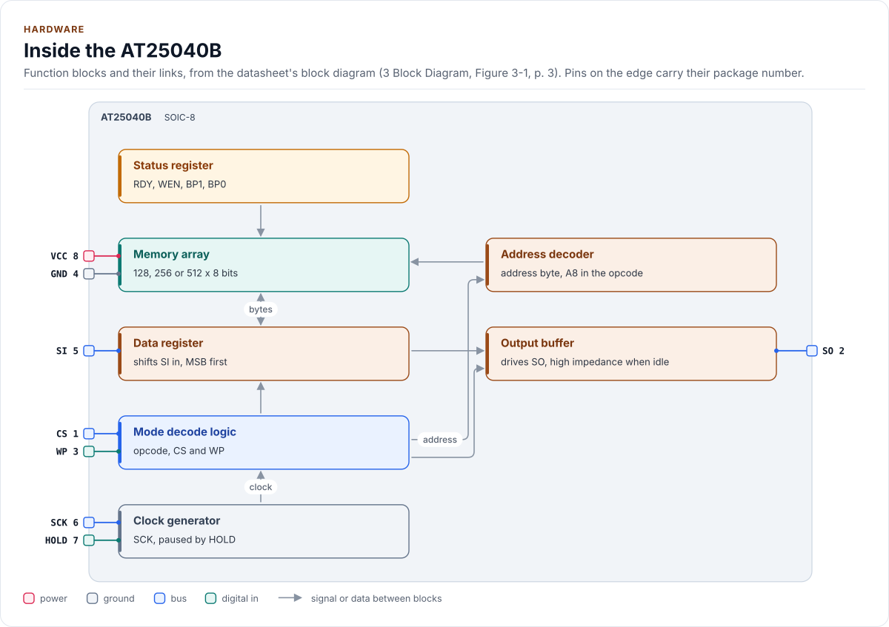
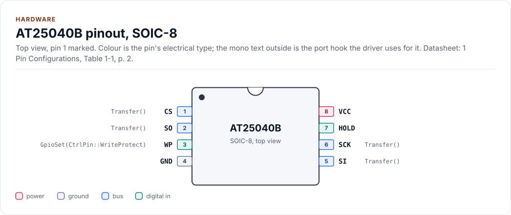
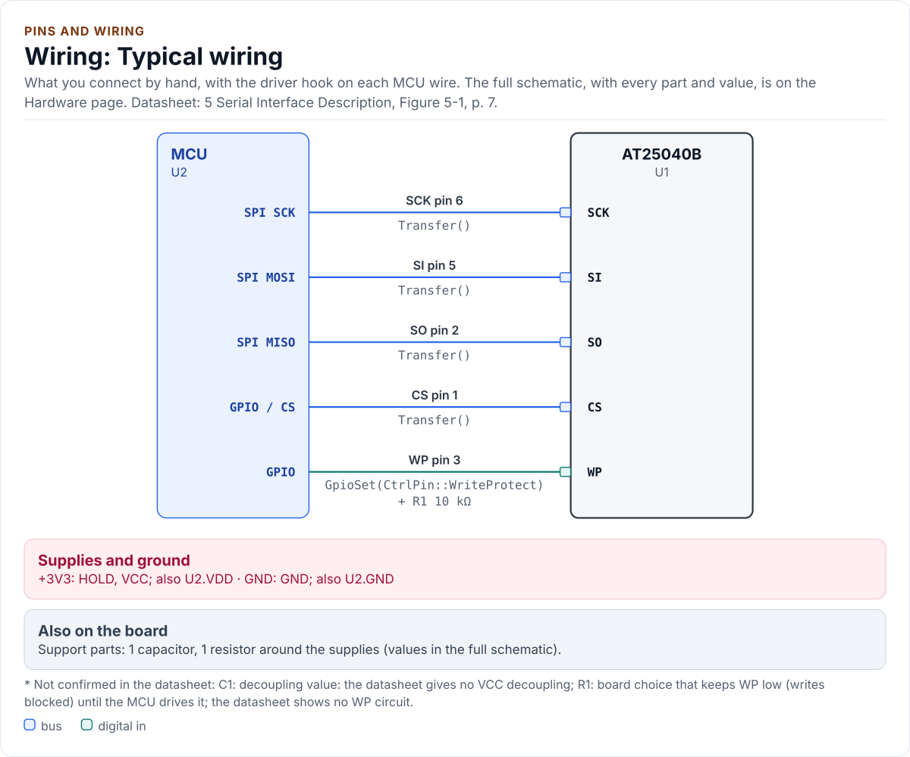
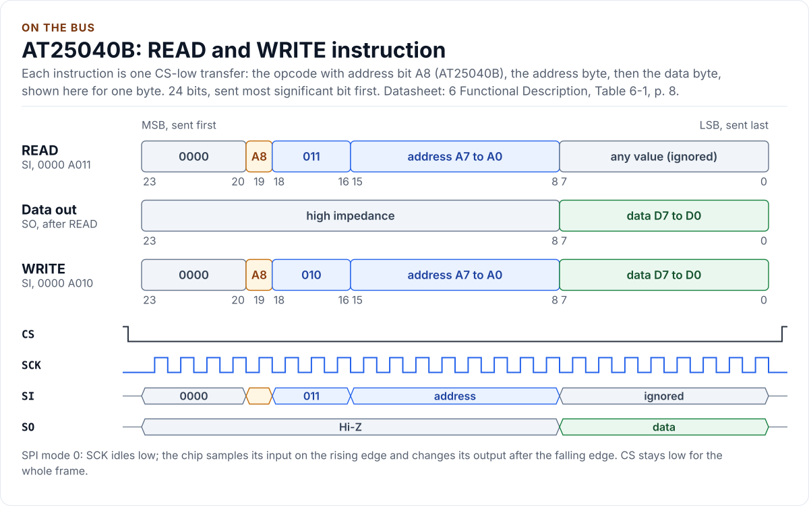

---
hide:
  - navigation
  - toc
---

Driver

# AT25040B Driver

<!-- generated: chip-summary -->
The **AT25040B** is a 1 Kbit, 2 Kbit or 4 Kbit serial EEPROM (128, 256 or 512 bytes) on an SPI bus: it keeps data with
the power off, writes a page in one self-timed cycle and protects a quarter, a half or all of the array (Features, [p.
1](https://ww1.microchip.com/downloads/en/DeviceDoc/Atmel-8707-SEEPROM-AT25010B-020B-040B-Datasheet.pdf#page=1)).
<!-- /generated -->

A C++20 driver for the Microchip (formerly Atmel) AT25010B, AT25020B and AT25040B SPI serial EEPROMs. It checks
that a chip really answers before trusting it, reads any range, writes page by page with the write enable latch,
the write cycle and a read-back checked at every step, drives the WP pin and sets the block protection, on any
MCU.

[Quickstart](quickstart.md){ .md-button .md-button--primary }
[API guide](api-guide.md){ .md-button }
[Source on GitHub](https://github.com/kokeb-labs-drivers/driver-at25040b){ .md-button }

<!-- figure: chip-hero -->
<picture>
  <source media="(prefers-color-scheme: dark)" srcset="diagrams/chip-hero.dark.svg">
  
</picture>
<!-- /figure -->

## What it does

<!-- figure: chip-capabilities -->
<picture>
  <source media="(prefers-color-scheme: dark)" srcset="diagrams/chip-capabilities.dark.svg">
  
</picture>
<!-- /figure -->

## Where it is used

<!-- generated: chip-uses -->
- Industrial and commercial equipment: where low power and low-voltage operation are essential

Uses named by the datasheet (Features, [p. 1](https://ww1.microchip.com/downloads/en/DeviceDoc/Atmel-8707-SEEPROM-AT25010B-020B-040B-Datasheet.pdf#page=1)).
<!-- /generated -->

## Inside the chip

<!-- figure: chip-blocks -->
<picture>
  <source media="(prefers-color-scheme: dark)" srcset="diagrams/chip-blocks.dark.svg">
  
</picture>
<!-- /figure -->

## Pins and wiring

<!-- figure: chip-pinout -->
<picture>
  <source media="(prefers-color-scheme: dark)" srcset="diagrams/chip-pinout.dark.svg">
  
</picture>
<!-- /figure -->

<!-- figure: chip-wiring-typical -->
<picture>
  <source media="(prefers-color-scheme: dark)" srcset="diagrams/chip-wiring-typical.dark.svg">
  
</picture>
<!-- /figure -->

<!-- figure: chip-frame-memory -->
<picture>
  <source media="(prefers-color-scheme: dark)" srcset="diagrams/chip-frame-memory.dark.svg">
  
</picture>
<!-- /figure -->

<!-- figure: chip-frame-status -->
<picture>
  <source media="(prefers-color-scheme: dark)" srcset="diagrams/chip-frame-status.dark.svg">
  
</picture>
<!-- /figure -->

The pin tables, the full schematic and the timing are on [Hardware](hardware.md).

## Driver coverage

<!-- generated: chip-coverage -->
| Capability | What the chip does | Driver API | Registers | Status | Datasheet |
| --- | --- | --- | --- | --- | --- |
| Sequential read | Reads one byte or the whole array in one transfer; the address counter rolls over at the top | `Read` | `kRead`, `kOpcodeA8` | Supported | 6, [p. 9](https://ww1.microchip.com/downloads/en/DeviceDoc/Atmel-8707-SEEPROM-AT25010B-020B-040B-Datasheet.pdf#page=9) |
| Page write | Writes up to an 8-byte page in one self-timed cycle, split at page boundaries, no erase first | `Write`, `Verify::ReadBack` | `kWrite`, `kWren` | Supported | 6, [p. 9](https://ww1.microchip.com/downloads/en/DeviceDoc/Atmel-8707-SEEPROM-AT25010B-020B-040B-Datasheet.pdf#page=9) |
| Status register | Reads ready/busy, the write enable latch and the block protection bits | `ReadStatus`, `GetLastStatusByte` | `kRdsr`, `kStatusRdy`, `kStatusWen`, `kStatusBusyByte` | Supported | 6, [p. 8](https://ww1.microchip.com/downloads/en/DeviceDoc/Atmel-8707-SEEPROM-AT25010B-020B-040B-Datasheet.pdf#page=8) |
| Block write protection | Makes the top quarter, the top half or all of the array read-only, kept without power | `SetBlockProtection`, `GetBlockProtection`, `BlockProtect::UpperHalf` | `kWrsr`, `kStatusBp0`, `kStatusBp1` | Supported | 6, [p. 9](https://ww1.microchip.com/downloads/en/DeviceDoc/Atmel-8707-SEEPROM-AT25010B-020B-040B-Datasheet.pdf#page=9) |
| Write protect and latch | Blocks writes with the WP pin and the write enable latch; the driver releases WP only while it writes | `GpioSet`, `CtrlPin::WriteProtect` | `kWren`, `kWrdi` | Supported | 6, [p. 8](https://ww1.microchip.com/downloads/en/DeviceDoc/Atmel-8707-SEEPROM-AT25010B-020B-040B-Datasheet.pdf#page=8) |
| Three densities | One driver for the 128, 256 and 512 byte parts; the AT25040B carries address bit A8 in the opcode | `Variant`, `GetCapacityBytes` | `kOpcodeA8`, `kAddressA8` | Supported | 6, [p. 8](https://ww1.microchip.com/downloads/en/DeviceDoc/Atmel-8707-SEEPROM-AT25010B-020B-040B-Datasheet.pdf#page=8) |
| SPI modes 0 and 3 | Publishes the mode, bit order and clock and select timing for each supply voltage | `kSpiMode`, `kSpiModeAlternate`, `kMaxClockHz`, `BusTimingAt` | - | Supported | 4.3, [p. 5](https://ww1.microchip.com/downloads/en/DeviceDoc/Atmel-8707-SEEPROM-AT25010B-020B-040B-Datasheet.pdf#page=5) |
| HOLD pin | Pauses a transfer while SCK is low; the driver never uses it, tie the pin to VCC | - | - | Not covered | 5, [p. 6](https://ww1.microchip.com/downloads/en/DeviceDoc/Atmel-8707-SEEPROM-AT25010B-020B-040B-Datasheet.pdf#page=6) |

**Supported**: the driver covers it and a host test checks it; **Not covered**: the chip has it and the driver leaves it
alone.

From [`docs/hardware.yml`](hardware.yml); `kokeb-docs hardware --check` confirms that every API name is in
`inc/at25040b.hpp`, `inc/at25040b_types.hpp`, `inc/at25040b_spi_interface.hpp` and every register in
`inc/at25040b_registers.hpp`.
<!-- /generated -->

The driver has no platform code. You give it a small class that brings the bus up, moves bytes and waits; it does
the rest: the identity check, the instruction framing with A8, the page split, the write cycle, the WP pin and the
checks that catch a dead or noisy bus.

## What you get

- **One object per chip.** `AT25040B<YourPort>` takes a reference to your port and does no I/O until
  `EnsureInitialized()`. See [API guide](api-guide.md).
- **A probe that a dead bus cannot pass.** The start-up check reads the status twice and toggles the write enable
  latch, so a floating, stuck or echoing MISO fails it. See [Contract](contract.md#the-identity-check).
- **Writes you can trust.** Page split, WREN per page, WEN checked, the write cycle waited for, each page read back.
  See [API guide](api-guide.md#write).
- **Errors you can act on.** Every call returns `Result<T>` with an `Error` such as `NoDevice`, `BusNoise` or
  `WriteProtected`. See [API guide](api-guide.md#handle-errors).
- **No heap, no exceptions, no RTTI.** The host tests build with `-fno-exceptions -fno-rtti`. See
  [Contract](contract.md).
- **Tested without hardware.** Host tests and a fuzzer run the driver against a protocol model of the chip. See
  [Testing and CI](testing.md). Not yet verified on hardware: [Status and limitations](limitations.md).

## Datasheet

<!-- generated: datasheet-card -->
| Document | Revision | Get it |
| --- | --- | --- |
| Datasheet: AT25010B, AT25020B, AT25040B SPI Serial EEPROM (Microchip (Atmel) Atmel-8707) | F, 2015-01 | [PDF](https://ww1.microchip.com/downloads/en/DeviceDoc/Atmel-8707-SEEPROM-AT25010B-020B-040B-Datasheet.pdf) · [vendor page](https://www.microchip.com/en-us/product/AT25040B) |

Written against these revisions; the SHA-256 of each file is in [`docs/datasheets.yml`](datasheets.yml). Where each part
of the driver is in the datasheet: [Datasheet map](datasheet.md).
<!-- /generated -->

## Where to go next

-   :material-rocket-launch-outline: **[Quickstart](quickstart.md)**

    ---

    Wire the chip, write the port, read the first bytes in about 15 lines.

-   :material-chip: **[Hardware](hardware.md)**

    ---

    Pins, instructions, timing, WP and HOLD, block protection.

-   :material-file-document-check-outline: **[Contract](contract.md)**

    ---

    What the driver promises, what it needs, threading and errors.

-   :material-code-braces: **[API guide](api-guide.md)**

    ---

    Probe, read, write, protect, and use it from a handler.

-   :material-swap-horizontal: **[Porting](porting.md)**

    ---

    Implement the port for your MCU.

-   :material-book-open-variant: **[API reference](api-reference.md)**

    ---

    Every class and member, generated from the headers.

